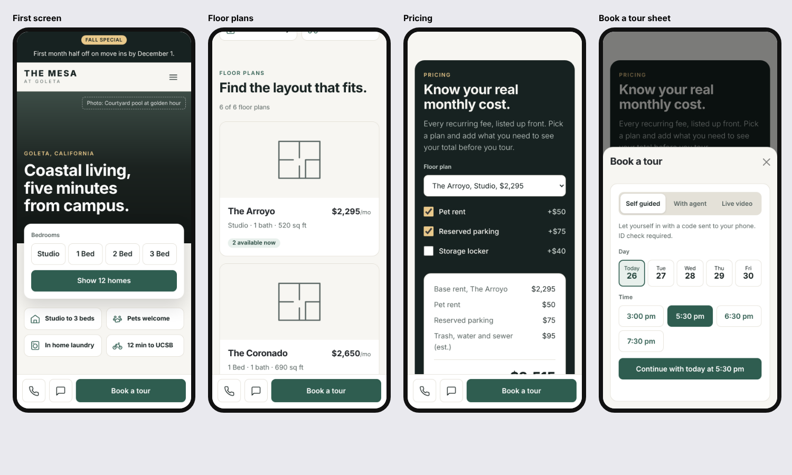

# Front Door

[](https://github.com/wesleycheungg/front-door/actions/workflows/tests.yml)

**Live:** [The Mesa](https://wesleycheungg.github.io/front-door/) · [Harborview](https://wesleycheungg.github.io/front-door/?property=harbor)

**A themeable website template for apartment communities.**

A property's website is its real front door. Most renters see it before they ever see the building. Front Door is one set of code that can power that website for any property. You only change one small file with that property's details.

It comes with two made up properties to show this:

* **The Mesa at Goleta:** green, modern look
* **Harborview Residences:** warm terracotta, classic look

Built with HTML, CSS, JavaScript, jQuery and Bootstrap. Designed for phones first.



## How to open it

1. Open this folder in VS Code.
2. Install the **Live Server** extension when VS Code suggests it.
3. Right click `index.html` and choose **Open with Live Server**.

To see the second property, add `?property=harbor` to the end of the address.

## What the site does

* **Search bar:** pick a bedroom size and see how many homes are open
* **Floor plans:** cards with price and availability
* **Tour booking:** pick self guided, with an agent or video, then a day and time
* **Pricing:** add pets or parking and see the full monthly cost
* **Neighborhood:** a real map plus walk, bike and drive times
* **On phones:** Call, Text and Book a tour buttons stay at the bottom of the screen

## Tests

Front Door has automated tests that run in Chrome, Firefox and Safari, on desktop and phone sizes (114 test runs in total). They read every property file, so a new property is tested automatically.

* **Behavior:** search, floor plans, tour times, pricing math and the map list work for each property
* **Accessibility:** axe scans every page for WCAG 2.2 AA problems
* **Visual:** each theme is compared to its last approved screenshot, so a change to the shared code cannot quietly break another property's look

To run them:

```
npm install
npx playwright install
npm test
```

After an intended design change, approve the new look with `npm run test:update-screenshots`. The first time you run the tests on a Mac, run that once to save screenshots for your computer.

The tests also run on GitHub every time you push code.

## How the files fit together

```
index.html          The page layout, the same for every property
css/theme.css       Colors and fonts for each property
css/fonts.css       Fonts, stored in the project
css/site.css        All other styles
js/site.js          Fills in the page and makes it interactive
properties/         One file per property with all its details
tests/              Automated tests and approved screenshots
screenshots/        Pictures of the finished site
vendor/             jQuery, Bootstrap, Leaflet (map) and fonts
```

## Adding a new property

1. Copy `properties/mesa.js` and rename it, for example `properties/oakwood.js`.
2. Change the name, prices, floor plans and other details inside it.
3. Add a color block for it in `css/theme.css`.
4. Open the site with `?property=oakwood`.

No other files need to change.

## How it would be maintained

If a property management company used Front Door, the work would split into three layers:

1. **Template** (`index.html`, `css/site.css`, `js/site.js`): one shared codebase for every property, maintained by developers. A change here updates every site at once.
2. **Theme** (`css/theme.css`): each property's colors, fonts and shapes, customized by a web designer when a client wants a new look.
3. **Content** (`properties/`): photos, specials and amenities, updated by the property's own staff.

Today all three are edited as files. The plan to make it work at scale is in `ISSUES.md`: an admin screen for staff, live prices from the property management software, and automated checks on every theme before a template change goes out.

## Photo credits

* Mesa courtyard pool: [Cory Bjork](https://unsplash.com/@corybjork) on Unsplash
* Mesa living room: [Bailey Alexander](https://unsplash.com/@baileyal3xander) on Unsplash
* Mesa pool with cabanas: [Jonathan Ikemura](https://unsplash.com/@ikemura) on Unsplash
* Harborview rooftop terrace: [Garrett Parker](https://unsplash.com/@garrettpsystems) on Unsplash
* Harborview living room: [Ahmet Çötür](https://www.pexels.com/@ahmetcotur) on Pexels
* Harborview amenities: [Kyle Ledyard](https://unsplash.com/@rosewooddecks) on Unsplash

## Good to know

* The property names, prices and fees are made up for this demo.
* Gray boxes mark where real photos go. Add a photo by setting its `src` in the property file.
* The map needs an internet connection to load.
* Bugs found and fixed while building are tracked in `ISSUES.md`.
